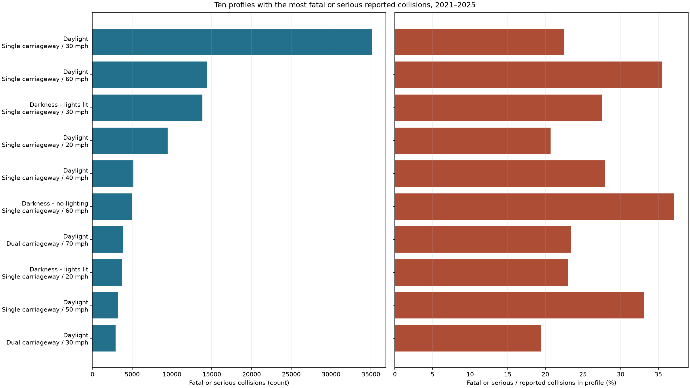
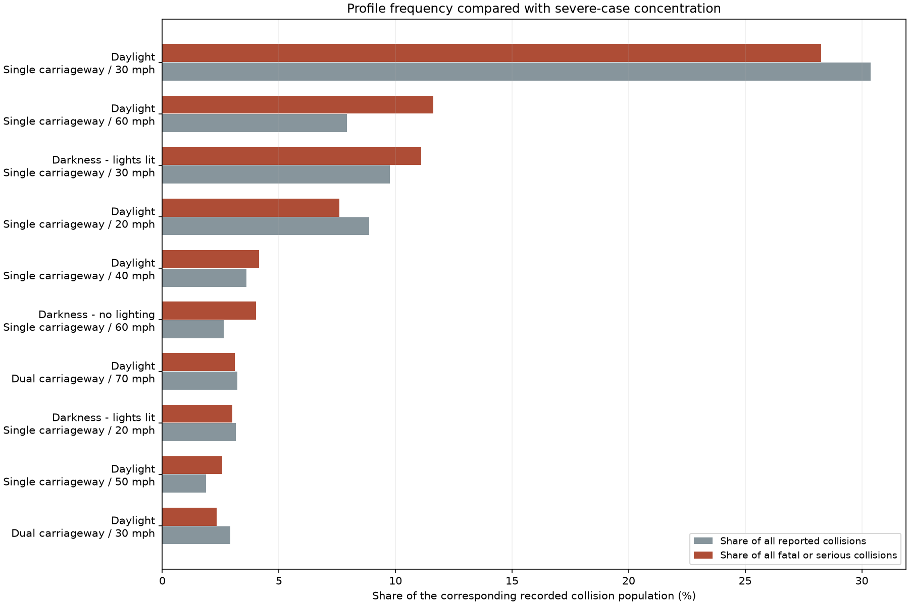
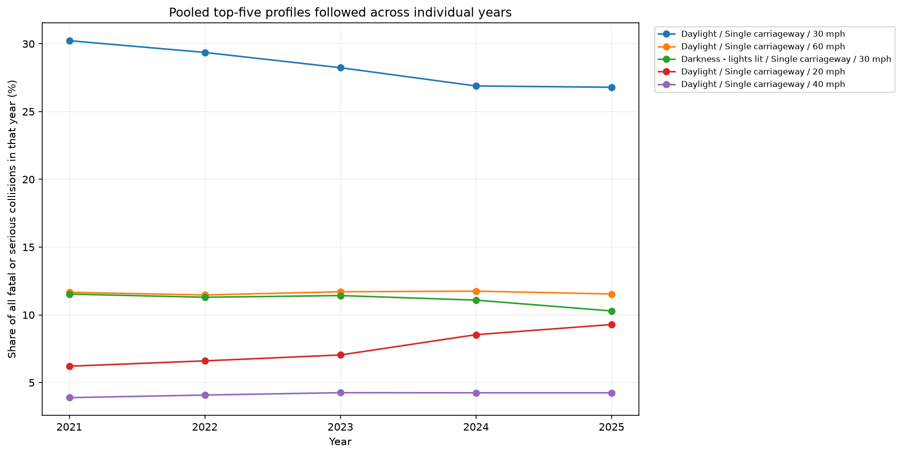
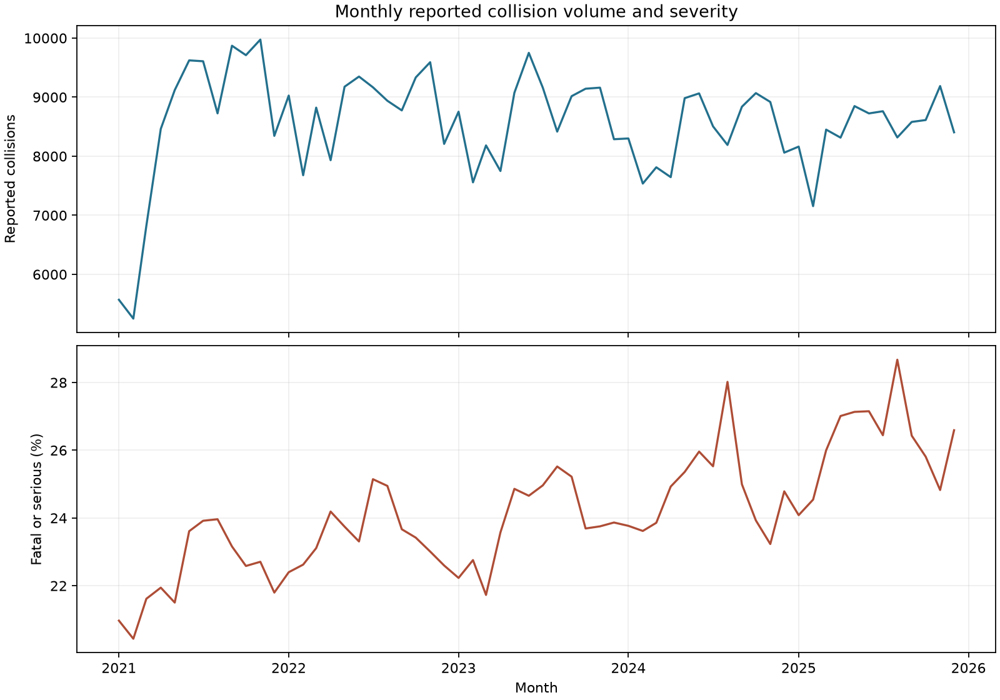
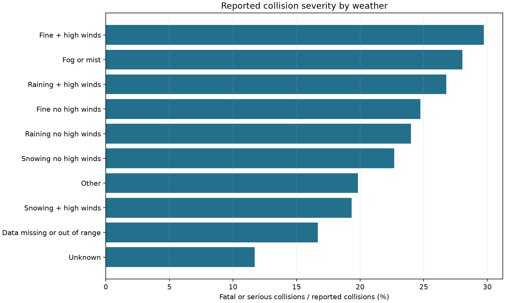
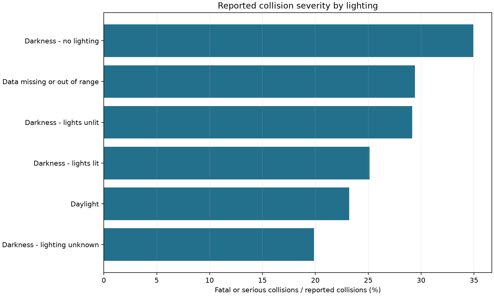
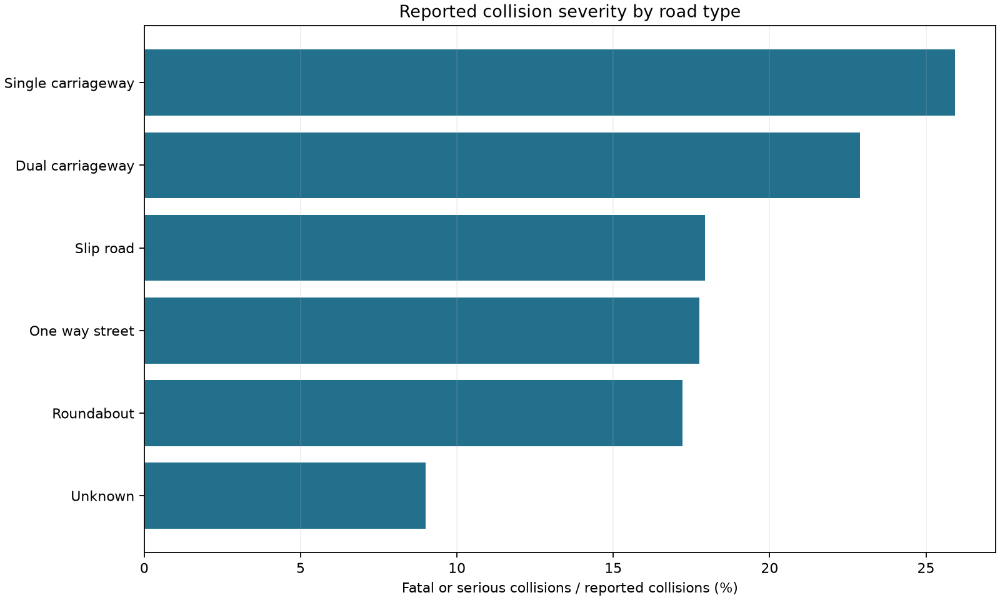

# STATS19 — Analytical Results

Validated Gold run: `20261110T150552746288Z`.

The snapshot contains **513,801 reported collisions**, **652,821 casualties**, and **124,366 fatal or serious collisions (24.205%)**.

**Question:** Which lighting, road-type and speed-limit profiles account for the largest numbers of fatal or serious reported collisions in Great Britain, 2021–2025?

These are descriptive, unadjusted reported-severity figures. Percentages are conditional on a recorded collision, not traffic exposure or causal effects. Changing severity recording practices can affect comparisons over time.

## Answer to the research question

**Daylight / Single carriageway / 30 mph accounts for the largest number of fatal or serious reported collisions: 35,130, or 28.247% of all severe collisions.** The five leading profiles together contain 78,008 severe collisions (62.725%).

The leading profile's within-profile severe proportion is 22.512%, compared with 24.205% across the snapshot. Its share of all recorded collisions is 30.371%. Its large severe caseload therefore accompanies a large recorded collision population; it does not establish a higher probability of a severe outcome than the overall recorded-collision reference.

### Does the pooled ranking hold each year?

The following profiles were selected from the pooled period, then followed in each year. Ranks use severe-case counts, with collision counts and profile codes breaking ties. The share gap is the share of severe collisions minus the share of all recorded collisions, calculated against each year's totals.

| Pooled leading profile | Years observed | Annual rank range | Years with positive / negative share gap |
|---|---|---:|---:|
| Daylight / Single carriageway / 30 mph | 2021, 2022, 2023, 2024, 2025 | 1–1 | 0 / 5 |
| Daylight / Single carriageway / 60 mph | 2021, 2022, 2023, 2024, 2025 | 2–2 | 5 / 0 |
| Darkness - lights lit / Single carriageway / 30 mph | 2021, 2022, 2023, 2024, 2025 | 3–3 | 5 / 0 |
| Daylight / Single carriageway / 20 mph | 2021, 2022, 2023, 2024, 2025 | 4–4 | 0 / 5 |
| Daylight / Single carriageway / 40 mph | 2021, 2022, 2023, 2024, 2025 | 5–5 | 5 / 0 |

**The same five profiles occupy ranks 1–5 in the same order in every year from 2021 to 2025.** This supports the descriptive consistency of the pooled result within the observed period. It is not independent validation or evidence that reporting changes have no effect.

### What should an analyst do with this result?

Use the largest severe-case groups to select where to investigate the recorded burden, and inspect within-profile severity alongside counts to identify different analytical priorities. Next, disaggregate these groups by location and year, review recording and road context, and obtain traffic volumes or distance travelled before comparing exposure-adjusted risk or choosing an intervention. The lighting, road-type and speed-limit associations cannot identify the effect of changing any one of those conditions.

## Profiles accounting for the largest numbers

The five largest profiles contain **78,008 fatal or serious collisions**, with an overall share of **62.725%**.

| Profile | All reported collisions | Fatal or serious | Within-profile severe (%) | Share of all collisions (%) | Share of all severe (%) | Gap (percentage points) |
|---|---:|---:|---:|---:|---:|---:|
| Daylight / Single carriageway / 30 mph | 156,048 | 35,130 | 22.512 | 30.371 | 28.247 | -2.124 |
| Daylight / Single carriageway / 60 mph | 40,725 | 14,458 | 35.502 | 7.926 | 11.625 | 3.699 |
| Darkness - lights lit / Single carriageway / 30 mph | 50,163 | 13,817 | 27.544 | 9.763 | 11.110 | 1.347 |
| Daylight / Single carriageway / 20 mph | 45,586 | 9,436 | 20.699 | 8.872 | 7.587 | -1.285 |
| Daylight / Single carriageway / 40 mph | 18,482 | 5,167 | 27.957 | 3.597 | 4.155 | 0.558 |
| Darkness - no lighting / Single carriageway / 60 mph | 13,484 | 5,006 | 37.125 | 2.624 | 4.025 | 1.401 |
| Daylight / Dual carriageway / 70 mph | 16,566 | 3,879 | 23.415 | 3.224 | 3.119 | -0.105 |
| Darkness - lights lit / Single carriageway / 20 mph | 16,176 | 3,724 | 23.022 | 3.148 | 2.994 | -0.154 |
| Daylight / Single carriageway / 50 mph | 9,649 | 3,193 | 33.092 | 1.878 | 2.567 | 0.689 |
| Daylight / Dual carriageway / 30 mph | 14,937 | 2,906 | 19.455 | 2.907 | 2.337 | -0.571 |

## Comparison with the recorded-collision reference

The gap is a profile's share of all severe collisions minus its share of all recorded collisions, in percentage points. A positive gap describes relative over-representation among recorded severe cases; a negative gap describes under-representation. This reference is not traffic exposure, and the gap is not a causal effect, a risk ratio or a statistical significance test.

## Analytical conclusions

1. **Largest recorded burden:** Daylight / Single carriageway / 30 mph accounts for 35,130 fatal or serious collisions (28.247% of all severe collisions). It also contains 30.371% of all recorded collisions; its severe-minus-all gap is -2.124 percentage points. A large absolute caseload does not alone indicate over-representation.

2. **Concentration:** the five leading profiles together account for an overall share of 62.725%. This is a description of the recorded caseload, not an exposure-adjusted risk ranking.

3. **Counts and proportions answer different questions:** among the ten profiles with the most severe collisions, the highest within-profile percentage is 37.125% for Darkness - no lighting / Single carriageway / 60 mph, based on 13,484 reported collisions, including 5,006 severe cases. Its shares of all recorded collisions and all severe collisions are 2.624% and 4.025%, respectively. A high percentage alone does not establish the largest absolute burden.

4. **Year-by-year check:** the pooled leading profile has annual severe-count ranks 1–1, and a negative share gap in 5 of 5 years. The contrasting profile has a positive share gap in 5 of 5 years. These are descriptive sensitivity checks on the same period, not out-of-sample validation. Reporting changes can still affect annual comparisons.

5. **Practical use:** an analyst can identify which profile groups warrant closer local examination, then obtain location, traffic-exposure and infrastructure information. These summaries do not determine an intervention or its effectiveness.

## Annual profile check

The five profiles are selected using the pooled period, then followed without changing the selection each year. A profile absent in a year is not labelled stable. Annual reference totals are reconciled separately to Silver.

## Supplementary temporal and environmental summaries

## Weather

| Category | Reported collisions | Fatal or serious (%) |
|---|---:|---:|
| Data missing or out of range | 12 | 16.667 |
| Fine no high winds | 413,632 | 24.738 |
| Raining no high winds | 55,834 | 24.007 |
| Snowing no high winds | 1,791 | 22.669 |
| Fine + high winds | 4,472 | 29.741 |
| Raining + high winds | 5,173 | 26.774 |
| Snowing + high winds | 238 | 19.328 |
| Fog or mist | 2,128 | 28.055 |
| Other | 15,955 | 19.831 |
| Unknown | 14,566 | 11.719 |

## Lighting

| Category | Reported collisions | Fatal or serious (%) |
|---|---:|---:|
| Data missing or out of range | 34 | 29.412 |
| Daylight | 368,193 | 23.195 |
| Darkness - lights lit | 105,834 | 25.113 |
| Darkness - lights unlit | 3,706 | 29.142 |
| Darkness - no lighting | 27,438 | 34.948 |
| Darkness - lighting unknown | 8,596 | 19.858 |

## Road Type

| Category | Reported collisions | Fatal or serious (%) |
|---|---:|---:|
| Roundabout | 31,178 | 17.208 |
| One way street | 11,550 | 17.749 |
| Dual carriageway | 76,119 | 22.893 |
| Single carriageway | 373,065 | 25.938 |
| Slip road | 8,829 | 17.941 |
| Unknown | 13,060 | 8.989 |

## Interpretation limits

Small groups can yield unstable percentages. Unknown categories are retained, and missing speed limits form a separate group. Vehicle-type groups may overlap: a collision involving a car and a cycle appears in both groups. The tables describe recorded personal injury collisions in Great Britain, not all road accidents.

Source: [Department for Transport, STATS19](https://www.gov.uk/government/statistical-data-sets/road-safety-open-data). See [severity guidance](https://www.gov.uk/government/publications/guide-to-severity-adjustments-for-reported-road-casualty-statistics) before interpreting time trends.
